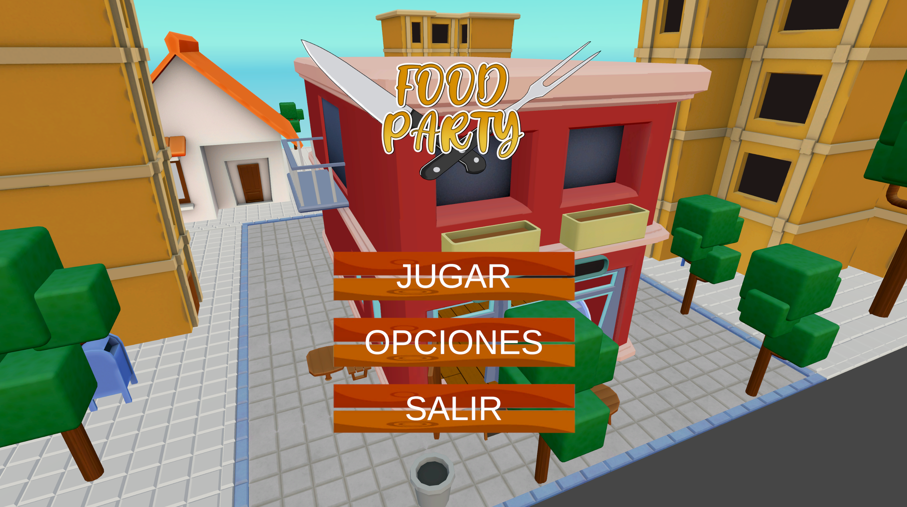

# Food Party

**A turn-based party game built with Unity and C#**  
**Project type:** Four-person student team project (approximately four months)
**Status:** Original student project; playable, with a browser demonstration being prepared

## Overview

Food Party is a turn-based party game in which players move around a board, encounter random events and compete in short minigames. The objective is to collect the ingredients needed for a cooking recipe and reach the final goal.

The game uses **AI-controlled opponents**, rather than online multiplayer. After all players complete their dice roll, a randomly selected minigame determines the rankings and influences the ingredient rewards awarded to each player.

This repository preserves the original project as a **programming portfolio showcase**. It is not presented as a commercially released or fully polished game.

## My role and contributions

I was the **programmer** on a team of four, while also contributing to some of the 2D artwork. My main contribution was implementing the gameplay systems in **C# using Unity**, working alongside teammates responsible for 3D characters, environments, rigging, skinning and animation.

The programming work involved:

- Implementing the turn-based board-game gameplay, including dice rolls, player movement and events.
- Implementing AI-controlled players so the game could be played without additional human players.
- Integrating several different minigames into the main game flow.
- Implementing the minigame ranking and ingredient-reward mechanics.
- Bringing the gameplay systems together with the characters, environments and animations created by the team.
- Testing and debugging the finished game to make the overall experience playable.

These descriptions summarise the work at a system level; specific implementation details can be explored in the C# source code.

## Gameplay at a glance

1. Players take turns rolling a dice and moving around the board.
2. Landing on different spaces can trigger events or other effects.
3. A randomly selected minigame brings the players into a short competition.
4. Higher-ranked players receive better ingredient rewards.
5. Players aim to complete their recipes and reach the end goal.

**New to the game?** The original version has limited visual guidance for some mechanics. A short gameplay walkthrough is planned to make the rules and progression easier to follow.

## Technologies

- **Game engine:** Unity
- **Programming language:** C#
- **Relevant experience:** Gameplay programming, turn-based systems, AI opponents, minigame integration, debugging and team collaboration

## Screenshots and demo

**Browser demo:** [Play on itch.io](https://pyxel-cosmos.itch.io/food-party)

**Gameplay video:** [](https://youtu.be/8mlMaiC_rDQ)

**Screenshots:** To be added.

> Before publication, replace these placeholders with working links and images. A short walkthrough of the first turn and one minigame would help new visitors understand the game quickly.

## Open the project in Unity

1. Install **Unity 2020.3.49f1**, as recorded in `ProjectSettings/ProjectVersion.txt`.
2. Clone the repository:
   ```bash
   git clone https://github.com/PyxelCosmos/OLD-Food-Party.git
   ```
3. In Unity Hub, use **Add project from disk** and select the folder containing the Unity project's `Assets`, `Packages` and `ProjectSettings` directories.
4. Open **MainMenu** scene, located at **Assets/TeamElementsAssets/Scenes** in the Unity Editor.
5. Enter Play mode to test the project.

## Team credits

Food Party was created by a four-person student team:

| Contribution | Team member |
| --- | --- |
| Programming and some 2D art | **Jack Benjamin Walton** |
| 3D art and character/environment assets | *Two teammates* |
| Character rigging and animation | *One teammate* |

The other contributors have given permission for their work to be included in this portfolio showcase. Their names will be added only if they wish to be credited publicly.

## Project status and limitations

This is the **original completed student project**. Its core gameplay is functional, although the user interface and visual feedback could explain the mechanics more clearly to new players. The repository is intended to show my programming contributions and what we achieved as a team, rather than present the project as a finished commercial product.

## Usage and rights

The code and assets are made available here for **portfolio review**. No open-source licence has been selected for reuse or redistribution. If you would like to reuse or redistribute any project material, please contact the relevant contributors first.

---

**Portfolio contact:** [Jack Benjamin Walton on LinkedIn](https://www.linkedin.com/in/jackbenjaminwalton/)
